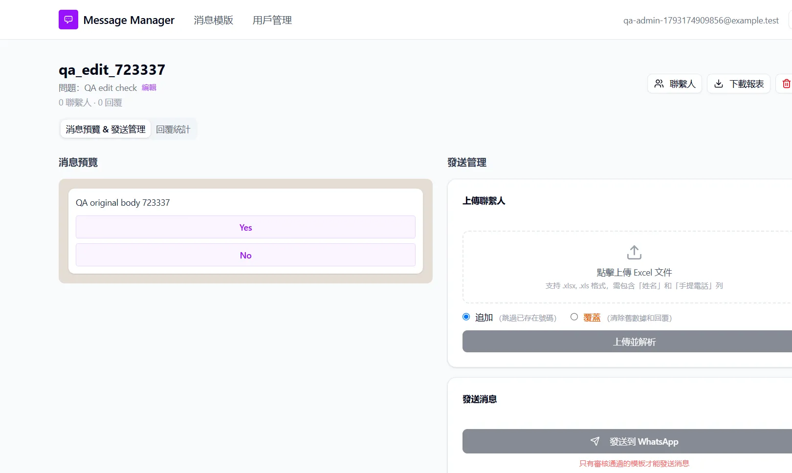

# Run report: tung-wah-whatsapp / manual-tww-098-2026-10-28 / local

| Field | Value |
|---|---|
| Result | **FAIL (1 failed)** |
| Run | 2026-10-28_1738_local_manual |
| Runner | manual |
| Base URL | http://localhost:3000/ |
| Started | 2026-10-28 17:38 |
| Duration | 0.9s |

## Summary

| Total | Pass | Fail | Flaky | Blocked | Skipped |
|---:|---:|---:|---:|---:|---:|
| 1 | 0 | 1 | 0 | 0 | 0 |

## Results

| ID | Title | Status | Checks | Time | Notes | Evidence |
|---|---|---|---|---|---|---|
| TWW-098 | Editing message text or buttons keeps the app and Twilio the same | fail | - | 0.0s | product-bug; BUG-034 | [1](screenshots/TWW-098-m01-tww098-1-edit-form.png) [2](screenshots/TWW-098-m02-tww098-2-app-after-edit.png) [3](screenshots/TWW-098-m03-tww098-3-twilio-unchanged.png) [4](screenshots/TWW-098-m04-tww098-4-app-after-sync.png) |

## Failures and warnings

### TWW-098: Editing message text or buttons keeps the app and Twilio the same (fail)

- Failure type: product-bug (bug BUG-034)
- Source: `projects/tung-wah-whatsapp/cases/templates/TWW-098-editing-message-text-or-buttons-keeps.md`
- Note: Throwaway Twilio draft qa_edit_723337 (no Meta, approved by user, deleted afterwards). Edit page saved body 'QA edited body 723337' and button 'Yes edited'; app showed them, Twilio kept 'QA original body 723337' Yes/No (Date updated unchanged). 從 Twilio 同步 then silently reverted the app to Twilio's content.

