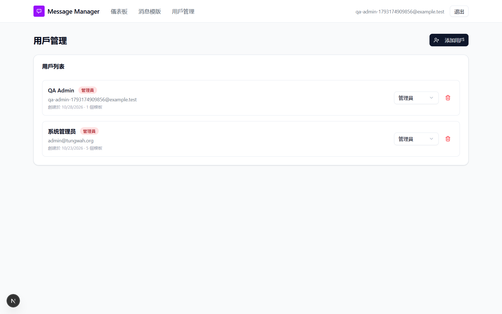

# Run report: tung-wah-whatsapp / retest-dev-fixes-af9a789 / local

| Field | Value |
|---|---|
| Result | **FAIL (5 failed)** |
| Run | 2026-10-29_1630_local_manual |
| Runner | manual |
| Base URL | http://localhost:3000/ |
| Started | 2026-10-29 16:30 |
| Duration | 5.0s |

## Summary

| Total | Pass | Fail | Flaky | Blocked | Skipped |
|---:|---:|---:|---:|---:|---:|
| 26 | 21 | 5 | 0 | 0 | 0 |

## Results

| ID | Title | Status | Checks | Time | Notes | Evidence |
|---|---|---|---|---|---|---|
| TWW-012 | Editor cannot see another user's contacts or report | pass | - | 0.0s | - | - |
| TWW-013 | Editor cannot send messages from another user's template (API) | pass | - | 0.0s | - | - |
| TWW-084 | Editor cannot change contacts of another user's template | pass | - | 0.0s | - | - |
| TWW-014 | Viewer cannot create templates or upload contacts | pass | - | 0.0s | - | - |
| TWW-088 | Sync shows each user only the templates they may see | pass | - | 0.0s | - | - |
| TWW-085 | Users cannot delete or edit other users' templates | pass | - | 0.0s | - | - |
| TWW-083 | Editor cannot open the user management page | pass | - | 0.0s | - | - |
| TWW-005 | User name of only spaces is rejected | pass | - | 0.0s | - | - |
| TWW-016 | Template name accepts only English letters, digits and underscore | pass | - | 0.0s | - | - |
| TWW-066 | Create form checks WhatsApp template limits before submitting | pass | - | 0.0s | - | - |
| TWW-029 | Append mode skips numbers already in the list | pass | - | 0.0s | - | - |
| TWW-030 | Upload summary reports rows that were not imported | pass | - | 0.0s | - | [1](screenshots/TWW-030-m01-bug007-upload-summary.png) |
| TWW-034 | Reset a sent contact to pending | pass | - | 0.0s | - | [1](screenshots/TWW-034-m01-bug011-after-reset.png) |
| TWW-037 | Sending is blocked while a template variable has no mapping | pass | - | 0.0s | - | - |
| TWW-046 | Webhook rejects requests without a valid Twilio signature | pass | - | 0.0s | - | - |
| TWW-055 | Reset warns before deleting recorded replies | pass | - | 0.0s | - | - |
| TWW-056 | Variable mapping must point to an existing Excel column | pass | - | 0.0s | - | - |
| TWW-057 | Report shows the text of free-text replies | pass | - | 0.0s | - | - |
| TWW-060 | Role change applies to existing sessions | pass | - | 0.0s | - | - |
| TWW-064 | Submit a two-variable template for Meta review | pass | - | 0.0s | - | [1](screenshots/TWW-064-m01-bug022-pending-card.png) |
| TWW-069 | Sync removes templates deleted in Twilio | pass | - | 0.0s | - | - |
| TWW-009 | User management page uses Traditional Chinese consistently | fail | - | 0.0s | product-bug; BUG-009 | [1](screenshots/TWW-009-m01-tww009-seed-admin-name.png) |
| TWW-039 | Contact status follows Twilio delivery and read receipts | fail | - | 0.0s | product-bug; BUG-013 | - |
| TWW-059 | Deleting a user ends their sessions | fail | - | 0.0s | product-bug; BUG-035 | [1](screenshots/TWW-059-m01-tww059-deleted-user-500.png) |
| TWW-081 | Logout invalidates the session token | fail | - | 0.0s | product-bug; BUG-036 | - |
| TWW-087 | Viewer has a read-only interface | fail | - | 0.0s | product-bug; BUG-037 | [1](screenshots/TWW-087-m01-tww087-viewer-ui.png) |

## Failures and warnings

### TWW-009: User management page uses Traditional Chinese consistently (fail)

- Failure type: product-bug (bug BUG-009)
- Source: `projects/tung-wah-whatsapp/cases/users/TWW-009-user-management-page-uses-traditional.md`
- Note: Labels are Traditional now; the seeded admin is still named 系统管理员 (prisma/seed.ts) on 用戶管理.

### TWW-039: Contact status follows Twilio delivery and read receipts (fail)

- Failure type: product-bug (bug BUG-013)
- Source: `projects/tung-wah-whatsapp/cases/sending/TWW-039-contact-status-follows-twilio-delivery.md`
- Note: Twilio message MM5ceb… went delivered then read; app stayed 已發送 (no status callback set). 已讀 appeared only after the member replied.

### TWW-059: Deleting a user ends their sessions (fail)

- Failure type: product-bug (bug BUG-035)
- Source: `projects/tung-wah-whatsapp/cases/security/TWW-059-deleting-a-user-ends-their-sessions.md`
- Note: APIs return 401 and session is empty after deletion (BUG-019 fixed), but opening /templates gives 500 TypeError reading role instead of /login.

### TWW-081: Logout invalidates the session token (fail)

- Failure type: product-bug (bug BUG-036)
- Source: `projects/tung-wah-whatsapp/cases/security/TWW-081-logout-invalidates-the-session-token.md`
- Note: After signout the copied session cookie still returns the user and /api/templates 200.

### TWW-087: Viewer has a read-only interface (fail)

- Failure type: product-bug (bug BUG-037)
- Source: `projects/tung-wah-whatsapp/cases/security/TWW-087-viewer-has-a-read-only-interface.md`
- Note: Viewer sees 新建模板 and 從 Twilio 同步; create form opens and fails only on submit with 無權限.

