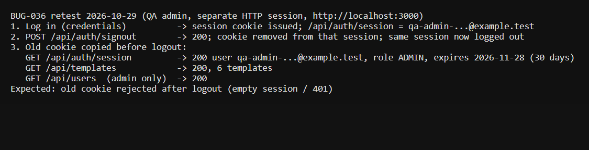

# Run report: tung-wah-whatsapp / bug-036-retest / local

| Field | Value |
|---|---|
| Result | **FAIL (1 failed)** |
| Run | 2026-10-29_1857_local_manual |
| Runner | manual |
| Base URL | http://localhost:3000/ |
| Started | 2026-10-29 18:57 |
| Duration | 0.5s |

## Summary

| Total | Pass | Fail | Flaky | Blocked | Skipped |
|---:|---:|---:|---:|---:|---:|
| 1 | 0 | 1 | 0 | 0 | 0 |

## Results

| ID | Title | Status | Checks | Time | Notes | Evidence |
|---|---|---|---|---|---|---|
| TWW-081 | Logout invalidates the session token | fail | - | 0.0s | product-bug; BUG-036 | [1](screenshots/TWW-081-m01-bug036.png) |

## Failures and warnings

### TWW-081: Logout invalidates the session token (fail)

- Failure type: product-bug (bug BUG-036)
- Source: `projects/tung-wah-whatsapp/cases/security/TWW-081-logout-invalidates-the-session-token.md`
- Note: QA admin logged in over HTTP, copied next-auth.session-token, signed out (200). Old cookie still returns the ADMIN session (expires 2026-11-28), /api/templates 200 and admin-only /api/users 200.

