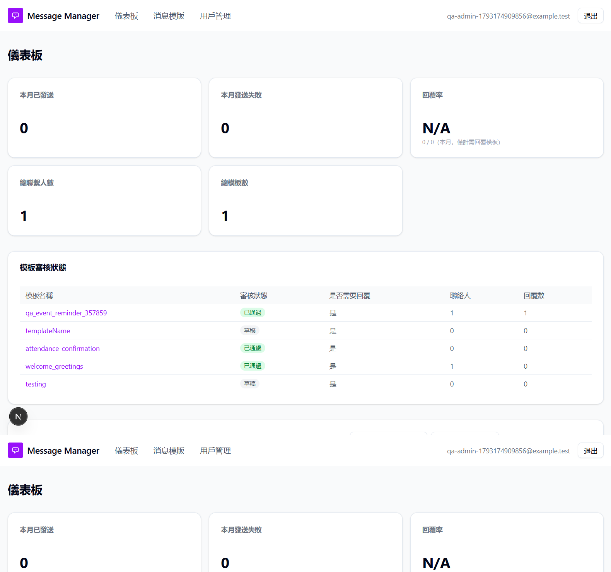
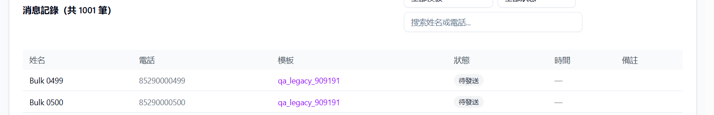
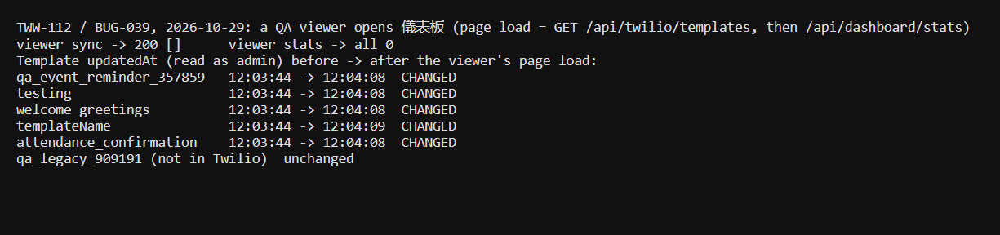

# Run report: tung-wah-whatsapp / dashboard-2026-10-29 / local

| Field | Value |
|---|---|
| Result | **FAIL (4 failed)** |
| Run | 2026-10-29_1906_local_manual |
| Runner | manual |
| Base URL | http://localhost:3000/ |
| Started | 2026-10-29 19:06 |
| Duration | 1.5s |

## Summary

| Total | Pass | Fail | Flaky | Blocked | Skipped |
|---:|---:|---:|---:|---:|---:|
| 4 | 0 | 4 | 0 | 0 | 0 |

## Results

| ID | Title | Status | Checks | Time | Notes | Evidence |
|---|---|---|---|---|---|---|
| TWW-108 | Dashboard numbers match the templates' contacts and replies | fail | - | 0.0s | product-bug; BUG-041 | [1](screenshots/TWW-108-m01-dash-admin.png) |
| TWW-109 | Dashboard covers every template the user's role can see | fail | - | 0.0s | product-bug; BUG-041 | [1](screenshots/TWW-109-m01-dash-admin.png) |
| TWW-111 | Dashboard message records filter, search and page correctly | fail | - | 0.0s | product-bug; BUG-040 | [1](screenshots/TWW-111-m01-p10.png) [2](screenshots/TWW-111-m02-p11.png) |
| TWW-112 | Opening the dashboard does not change or delete data | fail | - | 0.0s | product-bug; BUG-039 | [1](screenshots/TWW-112-m01-tww112.png) |

## Failures and warnings

### TWW-108: Dashboard numbers match the templates' contacts and replies (fail)

- Failure type: product-bug (bug BUG-041)
- Source: `projects/tung-wah-whatsapp/cases/dashboard/TWW-108-dashboard-numbers-match-the-templates.md`
- Note: QA admin: cards 本月已發送 0, 總聯繫人數 1, 總模板數 1, 回覆率 N/A, but 模板審核狀態 lists 5 templates incl. qa_event_reminder_357859 sent 29 Oct with 1 reply. Table per-template counts (聯絡人, 回覆數) match the templates. DB-only template qa_legacy_909191 is counted in the cards but not listed in the table.

### TWW-109: Dashboard covers every template the user's role can see (fail)

- Failure type: product-bug (bug BUG-041)
- Source: `projects/tung-wah-whatsapp/cases/dashboard/TWW-109-dashboard-covers-every-template-the-role.md`
- Note: QA admin sees only its own template in cards and 消息記錄; filtering by qa_event_reminder_357859 gives 暫無記錄. QA editor and QA viewer (created and deleted): all cards 0, empty status table, 0 records.

### TWW-111: Dashboard message records filter, search and page correctly (fail)

- Failure type: product-bug (bug BUG-040)
- Source: `projects/tung-wah-whatsapp/cases/dashboard/TWW-111-dashboard-message-records-filter-and-page.md`
- Note: 1000 contacts appended to qa_legacy_909191 (no send, removed afterwards). 共 1001 筆, 21 pages of 50; Bulk 0499 on page 10 and 11, Bulk 0999 never listed. Search by name, partial and full phone works; phone with spaces finds nothing; PENDING filter correct; ?status=bogus returns 500 (API only). Sent/failed rows and error 代碼 not checkable: no sent contacts visible to the QA admin (BUG-041).

### TWW-112: Opening the dashboard does not change or delete data (fail)

- Failure type: product-bug (bug BUG-039)
- Source: `projects/tung-wah-whatsapp/cases/dashboard/TWW-112-opening-the-dashboard-does-not-change-data.md`
- Note: Admin load: nothing deleted (all synced templates still in Twilio). Viewer load: sync returned [] but all 5 synced templates were upserted (updatedAt changed). Values unchanged this time since Twilio and app matched.

