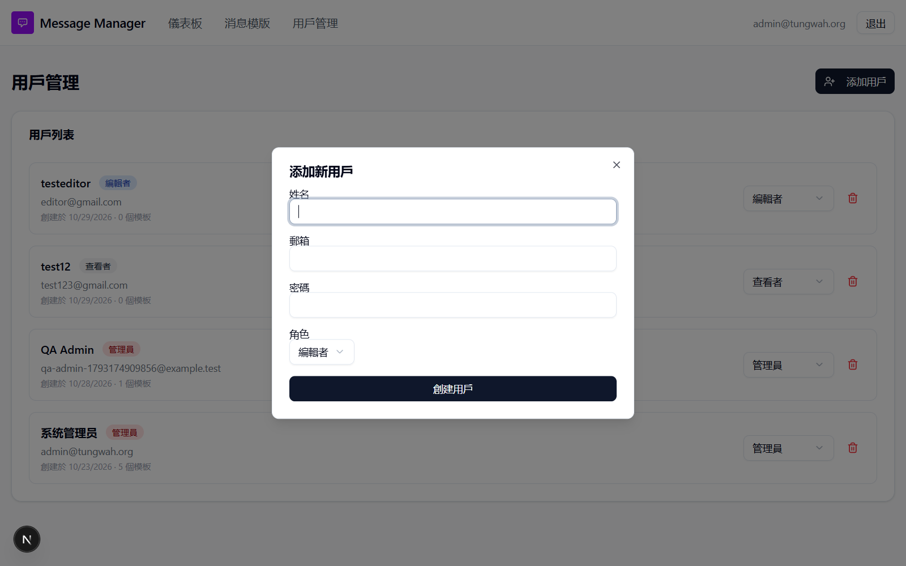

# Run report: tung-wah-whatsapp / console-sweep-2026-10-29 / local

| Field | Value |
|---|---|
| Result | **FAIL (1 failed)** |
| Run | 2026-10-29_1919_local_manual |
| Runner | manual |
| Base URL | http://localhost:3000/ |
| Started | 2026-10-29 19:19 |
| Duration | 0.5s |

## Summary

| Total | Pass | Fail | Flaky | Blocked | Skipped |
|---:|---:|---:|---:|---:|---:|
| 1 | 0 | 1 | 0 | 0 | 0 |

## Results

| ID | Title | Status | Checks | Time | Notes | Evidence |
|---|---|---|---|---|---|---|
| TWW-116 | Main pages show no errors or warnings in the browser console | fail | - | 0.0s | product-bug; BUG-042 | [1](screenshots/TWW-116-m01-users-dialog.png) |

## Failures and warnings

### TWW-116: Main pages show no errors or warnings in the browser console (fail)

- Failure type: product-bug (bug BUG-042)
- Source: `projects/tung-wah-whatsapp/cases/navigation/TWW-116-main-pages-show-no-errors-or-warnings.md`
- Note: Playwright sweep of 12 pages + template tabs, new-template dialog, dashboard search and add-user dialog. Admin: only the DialogContent warning on /users (BUG-042); 404s only on deliberately missing pages. Editor and viewer: 404 errors on the admin-created template pages (BUG-038/BUG-039, not this case). No page errors (uncaught exceptions) for any role.

