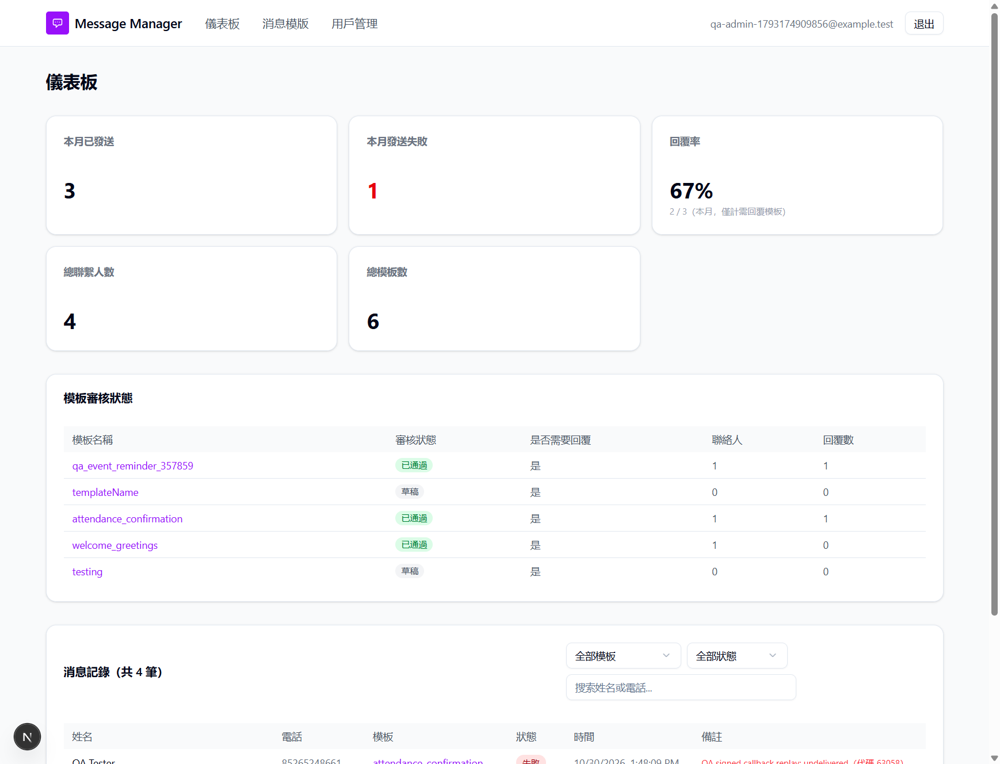

# Run report: tung-wah-whatsapp / report-retest-2026-10-30 / local

| Field | Value |
|---|---|
| Result | **FAIL (3 failed)** |
| Run | 2026-10-30_1349_local_manual |
| Runner | manual |
| Base URL | https://murmuring-amused-diaper.ngrok-free.dev/ |
| Started | 2026-10-30 13:49 |
| Duration | 8m 17s |

## Summary

| Total | Pass | Fail | Flaky | Blocked | Skipped |
|---:|---:|---:|---:|---:|---:|
| 12 | 9 | 3 | 0 | 0 | 0 |

## Results

| ID | Title | Status | Checks | Time | Notes | Evidence |
|---|---|---|---|---|---|---|
| TWW-081 | Logout invalidates the session token | pass | - | 0.0s | - | - |
| TWW-059 | Deleting a user ends their sessions | pass | - | 0.0s | - | - |
| TWW-098 | Editing message text or buttons keeps the app and Twilio the same | pass | - | 0.0s | - | - |
| TWW-012 | Editor can see every template's contacts and report | fail | - | 0.0s | product-bug; BUG-038 | [1](screenshots/TWW-012-m01-editor-report-404.png) |
| TWW-013 | Editor can send from a template another user created | pass | - | 0.0s | - | - |
| TWW-084 | Editor can manage the contacts of a template another user created | pass | - | 0.0s | - | - |
| TWW-088 | Sync shows every template to editors and viewers | pass | - | 0.0s | - | - |
| TWW-105 | Viewer can open and read every template | fail | - | 0.0s | product-bug; BUG-039 | [1](screenshots/TWW-105-m01-viewer-write-controls.png) |
| TWW-106 | Viewer's sync from Twilio does not change app data | pass | - | 0.0s | - | - |
| TWW-108 | Dashboard numbers match the templates' contacts and replies | fail | - | 0.0s | product-bug; BUG-043 | [1](screenshots/TWW-108-m01-missing-local-template.png) |
| TWW-109 | Dashboard covers every template the user's role can see | pass | - | 0.0s | - | - |
| TWW-039 | Contact status follows Twilio delivery and read receipts | pass | - | 0.0s | - | - |

## Failures and warnings

### TWW-012: Editor can see every template's contacts and report (fail)

- Failure type: product-bug (bug BUG-038)
- Source: `projects/tung-wah-whatsapp/cases/security/TWW-012-editor-cannot-read-another-user-s.md`
- Note: Shared template and contacts now open; editor export of admin-owned template still 404 {error:模板不存在}, reproduced twice. Creator-only check remains in export route.

### TWW-105: Viewer can open and read every template (fail)

- Failure type: product-bug (bug BUG-039)
- Source: `projects/tung-wah-whatsapp/cases/security/TWW-105-viewer-can-open-and-read-every-template.md`
- Note: Viewer shared detail, contacts and replies/stats work, but export still 404 twice and detail UI exposes write controls. Checked write endpoints still correctly reject with 403.

### TWW-108: Dashboard numbers match the templates' contacts and replies (fail)

- Failure type: product-bug (bug BUG-043)
- Source: `projects/tung-wah-whatsapp/cases/dashboard/TWW-108-dashboard-numbers-match-the-templates.md`
- Note: Card sums match data: 6 templates, 4 contacts, 3 sent, 1 QA synthetic failure, 2 replies, 67%. Status table lists only 5 Twilio-backed templates, omitting local-only qa_legacy_909191 whose contact appears in message records. Reproduced before and after send. Original role-scoping BUG-041 fixed.

## Notes

Retested attached report against build 1cdd076 via our ngrok tunnel. Five report bugs verified; BUG-038/039 partially fixed with shared export 404 and viewer write controls remaining. New BUG-043 covers local-only template omission. TWW-085 partly covered but excluded: editor live Twilio deletion not exercised. Delivery/read were real; failure callback was signed synthetic replay on disposable data. Setup repaired with explicit approval; all temporary QA data cleaned up.
