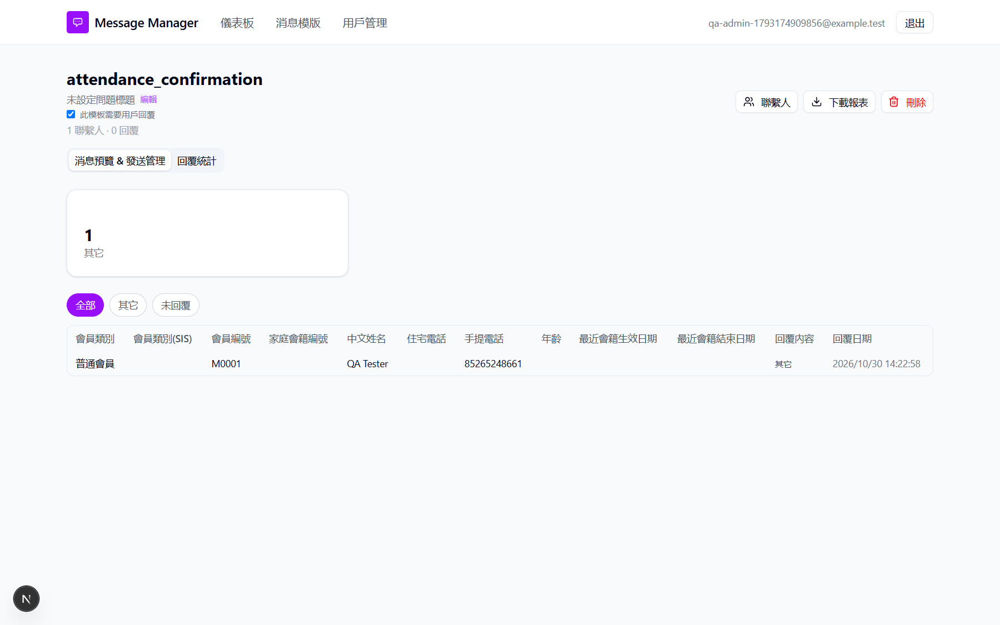

# Run report: tung-wah-whatsapp / sticker-reply-2026-10-30 / local

| Field | Value |
|---|---|
| Result | **FAIL (1 failed)** |
| Run | 2026-10-30_1421_local_manual |
| Runner | manual |
| Base URL | http://localhost:3000/ |
| Started | 2026-10-30 14:21 |
| Duration | 4m 44s |

## Summary

| Total | Pass | Fail | Flaky | Blocked | Skipped |
|---:|---:|---:|---:|---:|---:|
| 1 | 0 | 1 | 0 | 0 | 0 |

## Results

| ID | Title | Status | Checks | Time | Notes | Evidence |
|---|---|---|---|---|---|---|
| TWW-117 | Sticker reply is recorded as a non-text answer | fail | - | 0.0s | test-issue | [1](screenshots/TWW-117-m01-sticker-reply-other.png) |

## Failures and warnings

### TWW-117: Sticker reply is recorded as a non-text answer (fail)

- Failure type: test-issue
- Source: `projects/tung-wah-whatsapp/cases/replies/TWW-117-sticker-reply-is-recorded-as-a-non-text.md`
- Note: One approved send delivered to designated test phone. One inbound image/webp attachment with empty Body arrived via our ngrok webhook (200), counted once under Other. UI and exported 回覆紀錄!K6 show only 其它, no sticker/media label; 數據統計 counts 1. User asked to keep contact/reply/upload. No resend or cleanup.
- Note: User clarified that generic Other is expected for sticker/image replies. Original failed check reflected the earlier media-label expectation, not a product defect. BUG-046 is wont-fix; case expectations updated. The received attachment was counted once and exported as Other. No new execution or outcome rewrite.

## Notes

Sticker test through our ngrok tunnel. Single send only; real media reply received and counted, but no sticker/media label in UI or report (BUG-046). All test data retained at user request. No other reply types were tested.
