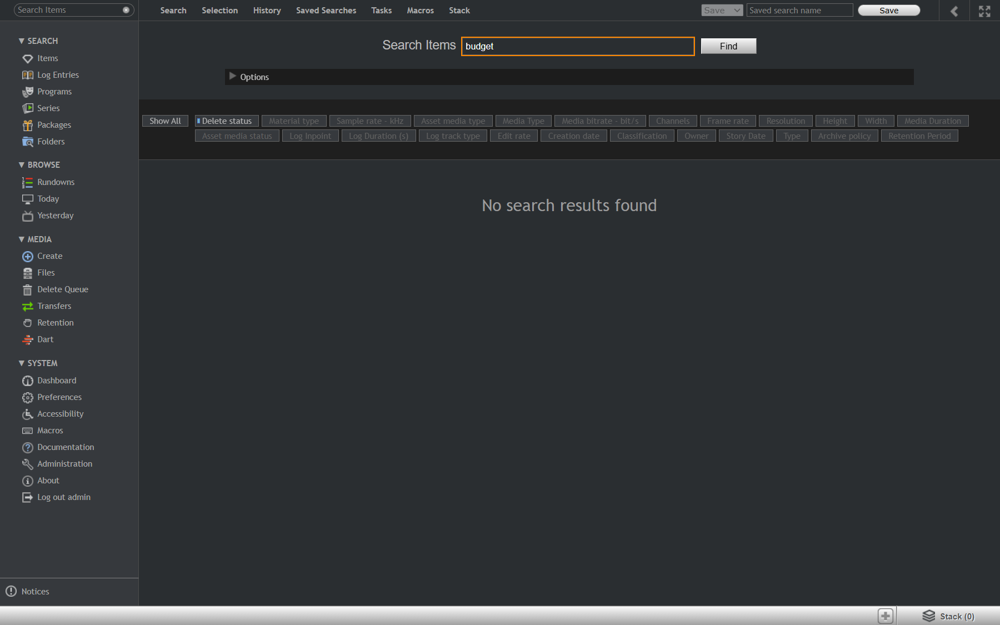

# Run report: vizone / manual / staging

| Field | Value |
|---|---|
| Result | **FAIL (1 failed)** |
| Run | 2026-10-30_1010_staging_manual |
| Runner | manual |
| Base URL | http://vizone-staging01.bh.rthkeng.hk/ |
| Started | 2026-10-30 10:10 |
| Duration | 7.8s |

## Summary

| Total | Pass | Fail | Flaky | Blocked | Skipped |
|---:|---:|---:|---:|---:|---:|
| 3 | 2 | 1 | 0 | 0 | 0 |

## Results

| ID | Title | Status | Checks | Time | Notes | Evidence |
|---|---|---|---|---|---|---|
| VZ-002 | Preview of a one to two hour item starts playing promptly | pass | - | 0.0s | - | - |
| VZ-008 | Chinese keyword search finds items with Chinese titles | pass | - | 0.0s | - | - |
| VZ-009 | English keyword finds an item that only has a Chinese title | fail | - | 0.0s | untriaged | [1](screenshots/VZ-009-m01-budget-no-results.png) |

## Failures and warnings

### VZ-009: English keyword finds an item that only has a Chinese title (fail)

- Failure type: untriaged
- Source: `projects/vizone/cases/search/VZ-009-english-keyword-finds-an-item-that-only.md`
- Note: budget returned No search results found; 財政預算案 finds the item. Bug vs future feature pending Q-002, so no bug filed yet.

## Notes

Exploration of staging while writing cases from the 28 Oct feedback. Only executed cases recorded.
