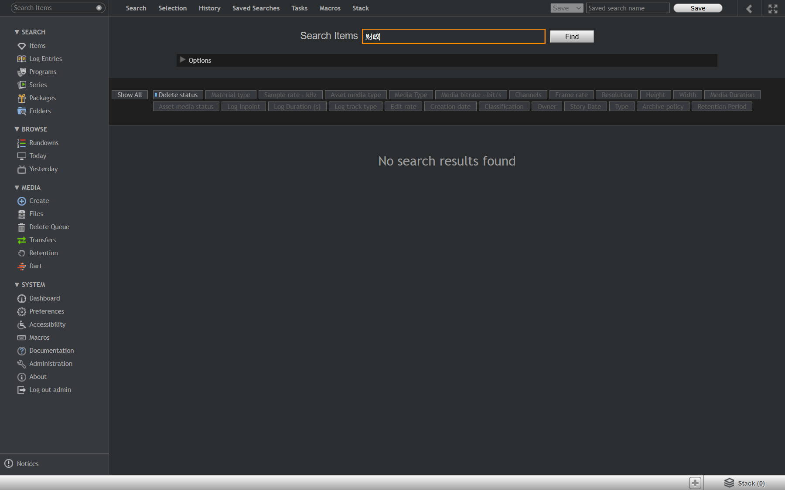
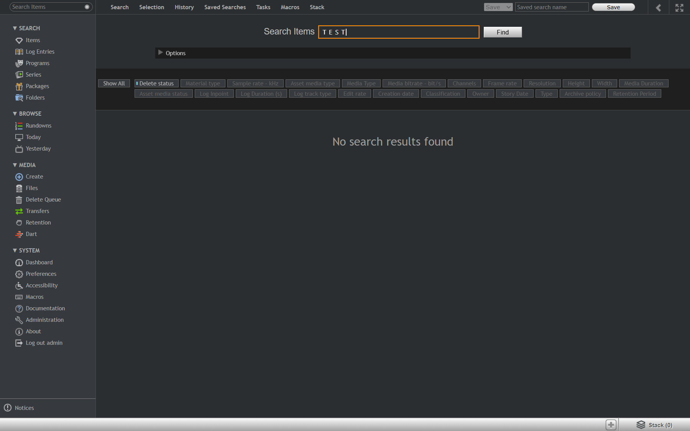
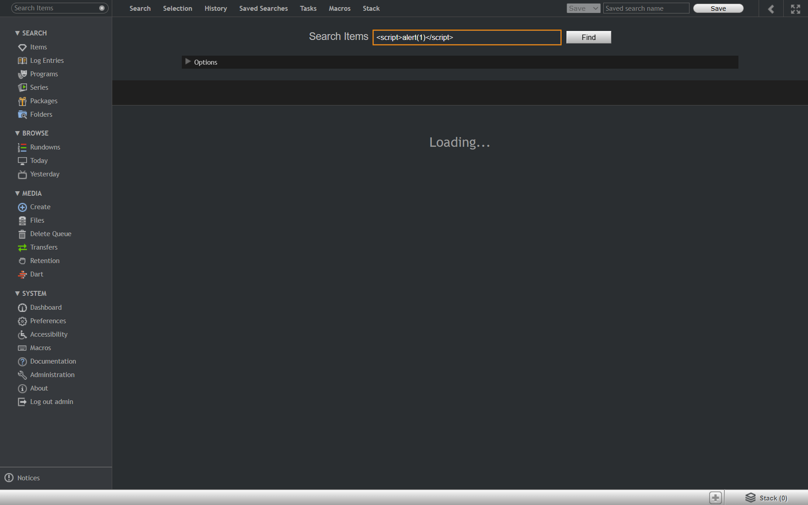
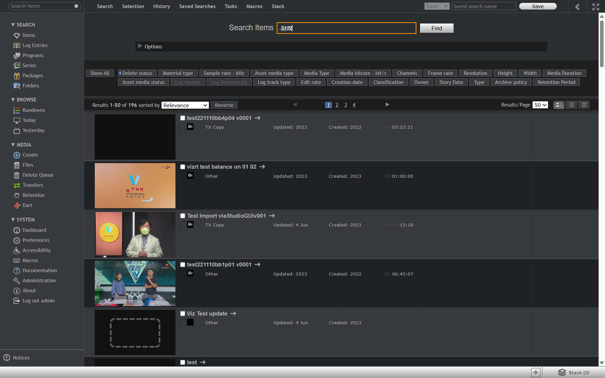

# Run report: vizone / manual / staging

| Field | Value |
|---|---|
| Result | **FAIL (4 failed)** |
| Run | 2026-10-30_1021_staging_manual |
| Runner | manual |
| Base URL | http://vizone-staging01.bh.rthkeng.hk/ |
| Started | 2026-10-30 10:21 |
| Duration | 3.1s |

## Summary

| Total | Pass | Fail | Flaky | Blocked | Skipped |
|---:|---:|---:|---:|---:|---:|
| 18 | 14 | 4 | 0 | 0 | 0 |

## Results

| ID | Title | Status | Checks | Time | Notes | Evidence |
|---|---|---|---|---|---|---|
| VZ-019 | Simplified Chinese keyword finds an item with a Traditional Chinese title | fail | - | 0.0s | untriaged | [1](screenshots/VZ-019-m01-evidence.png) |
| VZ-020 | Full-width Latin keyword finds items with half-width titles | fail | - | 0.0s | untriaged | [1](screenshots/VZ-020-m01-evidence.png) |
| VZ-021 | Search ignores letter case | pass | - | 0.0s | - | - |
| VZ-022 | Extra spaces in a Chinese keyword do not change the results | pass | - | 0.0s | - | - |
| VZ-023 | Search with no matches shows a clear empty result | pass | - | 0.0s | - | - |
| VZ-024 | Search text that looks like HTML or script finishes and is not executed | fail | - | 0.0s | product-bug; BUG-001 | [1](screenshots/VZ-024-m01-evidence.png) |
| VZ-025 | Very long keyword returns no results without an error | pass | - | 0.0s | - | - |
| VZ-026 | Wildcard search matches title prefixes | pass | - | 0.0s | - | - |
| VZ-027 | Excluding a keyword removes the matching items | fail | - | 0.0s | untriaged | [1](screenshots/VZ-027-m01-evidence.png) |
| VZ-029 | Item without a proxy shows Missing proxy instead of a broken player | pass | - | 0.0s | - | [1](screenshots/VZ-029-m01-missing-proxy.png) |
| VZ-030 | Item with no media shows No media | pass | - | 0.0s | - | - |
| VZ-031 | Typing a time code jumps the player to that frame | pass | - | 0.0s | - | - |
| VZ-032 | Typing a time code past the end goes to the last frame | pass | - | 0.0s | - | - |
| VZ-033 | Invalid time code text is ignored | pass | - | 0.0s | - | - |
| VZ-036 | Wrong password is rejected with a clear message | pass | - | 0.0s | - | - |
| VZ-037 | Empty username is rejected | pass | - | 0.0s | - | - |
| VZ-038 | Username is case sensitive | pass | - | 0.0s | - | - |
| VZ-039 | Item link opened while logged out returns to the item after login | pass | - | 0.0s | - | - |

## Failures and warnings

### VZ-019: Simplified Chinese keyword finds an item with a Traditional Chinese title (fail)

- Failure type: untriaged
- Source: `projects/vizone/cases/search/VZ-019-simplified-chinese-keyword-finds-an.md`
- Note: 财政 -> No search results found; 財政 -> 22 results. Pending Q-003.

### VZ-020: Full-width Latin keyword finds items with half-width titles (fail)

- Failure type: untriaged
- Source: `projects/vizone/cases/search/VZ-020-full-width-latin-keyword-finds-items.md`
- Note: ＴＥＳＴ -> No search results found; TEST -> 89. Pending Q-003.

### VZ-024: Search text that looks like HTML or script finishes and is not executed (fail)

- Failure type: product-bug (bug BUG-001)
- Source: `projects/vizone/cases/search/VZ-024-search-text-that-looks-like-html-or.md`
- Note: <b>bold</b> OK;  stuck on Loading Search Results 25+ s, no request sent.

### VZ-027: Excluding a keyword removes the matching items (fail)

- Failure type: untriaged
- Source: `projects/vizone/cases/search/VZ-027-excluding-a-keyword-removes-the.md`
- Note: -財政 and NOT 財政 both 196 (all), expected 174. Pending Q-003.

## Notes

Edge-case exploration on staging; only executed cases recorded.
